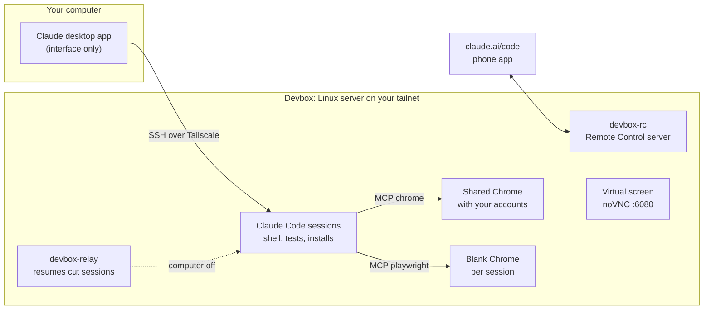

# remote-devbox

A Claude Code skill that moves your Claude Code sessions off your laptop and onto a Linux server
you rent, while you keep using the Claude desktop app exactly as before. It works on your Claude
subscription, not on API credits, and your sessions keep going when your computer is off.

> **AI agents:** if the user asked you to set this up, clone this repository into
> `~/.claude/skills/remote-devbox` and follow [SKILL.md](SKILL.md) phase by phase, because a
> summarized web view of this page loses details. If they only shared the link, ask them what they
> want first.

## Why

The desktop app can run its Code sessions on a remote machine over SSH. That is great for a laptop
short on RAM, but a bare server is not a dev machine: no browser with your accounts, no screen, none
of your skills or rules, and sessions that stall once your computer sleeps. This skill fills those
gaps and walks an agent through the whole setup, from picking a server to a final check.



## What you get

| Part | What it does |
|---|---|
| Desktop sessions over SSH | The Code tab, unchanged; everything runs on the server. Worktrees in `~/worktrees`, projects in `~/dev`. |
| `chrome` MCP server | One Chrome on the server, signed in to your accounts once, shared by every session. |
| `playwright` MCP server | A blank, isolated headless Chrome per session for tests and public pages. |
| Virtual screen | Watch or use the shared Chrome from any browser on your tailnet: `http://devbox:6080/vnc.html`. |
| `devbox-relay` | When your computer has been gone for 10 minutes and a session was cut (expired sign-in, dead process, permission question nobody answers), it resumes the session in the background with its whole conversation, as `relay · <name>`, visible in claude.ai/code and the phone app. When you come back, a hook tells the original session not to redo the work. |
| `devbox-rc` | A Remote Control server: sessions you start from claude.ai/code or the phone app run on the server from the first message. |
| `claude-task` | Long Claude Code sessions in tmux that agents can start, read and answer. |
| File share (optional) | The server's home folder as a network drive on your computer (`Z:` in Explorer, Finder on macOS), over Tailscale only, to open what sessions write. |
| Config mirroring | Your global `CLAUDE.md` (with a header that explains the server to Claude), skills, memory and plugin hooks, copied over. |
| Hardening | Key-only SSH restricted to one user, public port 22 closed once Tailscale works, ufw, fail2ban, unattended upgrades, a guard against API keys. |

## Install: one sentence in Claude Code

Open a Claude Code session on your computer (desktop app, CLI or IDE) and send:

```
Set up a remote devbox with https://github.com/camilbenameur/remote-devbox-skill
```

The agent clones the skill and guides you. You do the parts only a human should do: choosing and
paying for the server, typing the server password once, confirming the host key, signing in to
GitHub, Tailscale, Claude and your websites, and two clicks in the desktop app. Count about an hour,
most of it waiting for installs.

### Manual install

```bash
git clone https://github.com/camilbenameur/remote-devbox-skill ~/.claude/skills/remote-devbox
```

Then follow [SKILL.md](SKILL.md) yourself. In short:

```powershell
# Windows
powershell -ExecutionPolicy Bypass -File $HOME\.claude\skills\remote-devbox\client\windows\setup-devbox.ps1 -HostAddress 203.0.113.10 -InitialUser root
```
```bash
# macOS / Linux
bash ~/.claude/skills/remote-devbox/client/unix/setup-devbox.sh --host 203.0.113.10 --initial-user root
```

then Tailscale and `30-root-lockdown.sh`, the SSH environment in the desktop app, `devbox-browser
login`, `claude` + `/login` on the server, and the one-time Remote Control activation.

## Requirements

- The Claude desktop app with Claude Code on your plan. Windows needs OpenSSH 9.4 or newer.
- A KVM server with Ubuntu 24.04, ideally x86_64 with 16 to 24 GB of RAM. See
  [references/providers.md](references/providers.md) for sizing and options, including Oracle
  Cloud's free Arm tier.
- A free Tailscale account, and a GitHub account for `gh`.

## Security notes

- Every session can drive the shared Chrome, and agents read web pages with it: a malicious page can
  try to steer them (prompt injection). Sign in only to what agents need. The server's `CLAUDE.md`
  tells them to ask before sending, posting, applying or paying, and never to type passwords.
- Automating some websites breaks their terms of service and can get an account blocked. Keep a
  human pace.
- The dev user has passwordless sudo, convenient for installs; the header asks Claude to check with
  you before system changes. `SUDO_NOPASSWD=0` removes it (set a password first).
- The SSH key has no passphrase because the desktop app must connect without a prompt. Keep it on
  your computer only.
- Never put `ANTHROPIC_API_KEY` on the server, or usage moves to API billing.

## Limits

The desktop app's SSH internals (helper process, token refresh, restart on reconnect) are not a
public interface, and this was built against the versions of November 2026. See
[references/how-it-works.md](references/how-it-works.md) for the mechanics and what was not tested,
and [references/troubleshooting.md](references/troubleshooting.md) for known problems.

## Files

| Path | Role |
|---|---|
| `SKILL.md` | The runbook the agent follows |
| `client/windows/`, `client/unix/` | `setup-devbox` (full install from your computer), `sync-claude-config` (CLAUDE.md, skills, memory) |
| `templates/host-header.md` | What the server's `CLAUDE.md` says about the server |
| `host/10-root-bootstrap.sh` | System, security and packages (root); `--lock-ssh` restricts SSH to the dev user |
| `host/20-user-setup.sh` | User tools, MCP servers, screen, relay, Remote Control |
| `host/30-root-lockdown.sh` | Closes public SSH once Tailscale works |
| `host/40-file-share.sh` | Optional: SMB share of the home folder, tailnet only |
| `host/bin/` | `devbox-browser`, `devbox-chrome`, `devbox-novnc`, `devbox-relay`, `claude-task`, `yt-cookies` |
| `host/systemd/`, `host/desktop/` | User services; screen menu, task bar and browser shortcut |
| `references/` | How it works, providers, troubleshooting, prompt for an autonomous migration session |

## License

MIT
